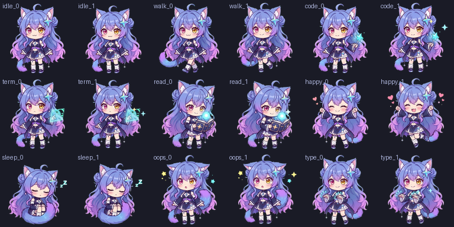
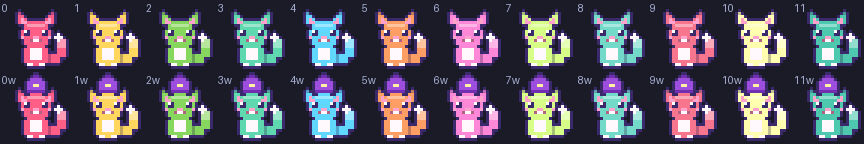
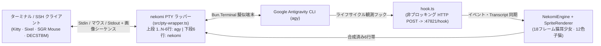

<div align="center">


# nekomi

**Google Antigravity CLI（`agy`）向けのターミナル常駐・猫耳少女コンパニオンプラグイン**  
*Kitty Graphics · Sixel · 24-bit ハーフブロックフォールバック · SSH ネイティブ · 100% Bun ランタイム*

[](https://github.com/wray-lee/nekomi)
[](https://bun.sh)
[](./src/gfx-protocol.ts)
[](#-クイックスタート)
[](./LICENSE)

[English](./README.md) · [简体中文](./README.zh-CN.md) · **日本語**

[ビジュアル](#-ビジュアルショーケース) · [特徴](#-主な特徴) · [クイックスタート](#-クイックスタート) · [画像プロトコル](#-対応ターミナルプロトコル) · [操作方法](#-操作インタラクション) · [アーキテクチャ](#-アーキテクチャ)

</div>

---

**nekomi** は、`agy` の動作状態に合わせてターミナルや SSH セッションの画面下部に常駐する猫耳少女コンパニオンです。Bun ネイティブ PTY（`Bun.Terminal`）、**コード生成の `256×256` スーパーサンプリング・アニメ塗りスプライト**、**Kitty / Sixel 画像プロトコル**、SGR マウスクリック反応、リアルタイムタイピング連動、そして **12色のドット絵子猫サブエージェント** を備えています。

[`wray-lee/clawd`](https://github.com/wray-lee/clawd) に着想を得て、Google Antigravity CLI 向けにキャラクター統合型の完全オリジナルアニメーションとして再構築しました。

---

## ✨ ビジュアルショーケース

### メインキャラクター — 18フレーム統合アニメーション（`256×256 → 128×128 PNG / 96×96 Sixel`）

<div align="center">
  
</div>

外部の ASCII 枠ではなく、小道具やエフェクトまで**キャラクター自身のスプライト内に統合描画**されています：
- `idle_0 / idle_1` — `:3` の口元、まばたき、片耳ピクピク、しっぽ揺れ
- `walk_0 / walk_1` — 思考中の軽やかなお散歩と袖揺れ（`PreInvocation`）
- `code_0 / code_1` — 輝く4芒星の杖と周回する星屑（`edit_file`、`write_file`、`run_workflow`）
- `term_0 / term_1` — 浮遊する星光クリスタルルーン端末をタッチ（`run_command`、`call_mcp_tool`、`browser_*`）
- `read_0 / read_1` — 光るグリモワールと浮かぶ星玉（`read_file`、`search_web`、`plan`、`update_steps`）
- `happy_0 / happy_1` — `^ ^` の笑顔、肉球付き招き猫ポーズ＆ハート（`hello`、`pet`、`celebrate`、`highfive`）
- `sleep_0 / sleep_1` — 10分間無操作で丸くなってお昼寝＋浮かぶ `z` / `Z`
- `oops_0 / oops_1` — びっくり見開き目、伏せ耳、逆立ちもふもふ尻尾＆めまい星（`error`、`bonk`、`zap`）
- `type_0 / type_1` — キー入力に合わせて素早く両手をパタパタ（`echo`）

### サブエージェント Helpers — 12色ドット絵子猫（`72×72 PNG / 48×48 Sixel`）

<div align="center">
  
</div>

稼働中のサブエージェントはカラフルな子猫たちとして後ろに並び、ネスト深度に応じたサイズで跳ねたりまばたきしたりします。`run_workflow` 担当の子猫は**紫色の星付きウィザードハット**を着用します。

---

## 🚀 主な特徴

- **純コード生成の高精細スプライト**：Python による `256×256` スプライン曲線と滑らかな縦グラデーション描画から、透過 PNG（`128×128`）および透過背景 `P2=1` Sixel（`96×96`）を生成。
- **Kitty 遅延アップロードで SSH でも高速起動**：起動時の事前一括送信を行わず、初登場フレームのみ静音チャンク Base64（`q=2`）で転送し、以降は極小の配置コマンド（`d=i` / `a=p`）のみで滑らかにアニメーション。
- **SSH 単一ウィンドウ完結（`tmux` 不要）**：`Bun.Terminal` と DECSTBM で下部6行を確保し、上部の `agy` 画面と干渉しません。
- **ネイティブ `agy` Plugin 対応**：[`plugin.json`](./plugin.json)、ルート [`hooks.json`](./hooks.json)（ツールを一切ブロックしない5つの観測フック、`PreToolUse` 不使用）、[`nekomi-setup`](./skills/nekomi-setup/SKILL.md) スキルを同梱。
- **100% Bun ランタイム**：`bun` のみで動作し、Node / npm には依存しません。

---

## 📦 クイックスタート

### 1. 動作要件

- [**Bun**](https://bun.sh) `>= 1.2.0`
- **Google Antigravity CLI**（`agy`）

### 2. `agy` Plugin としてインストール（Hooks + Skill）

```sh
agy plugin install https://github.com/wray-lee/nekomi
```

### 3. nekomi を起動する

> [!NOTE]
> `agy` の子プロセスであるフックは既に開かれた親ターミナルの行数変更や raw `stdin` マウスイベントの横取りができないため、以下の PTY ラッパー経由（またはシェルラッパー関数経由）で `agy` を起動してください：

```sh
# インタラクティブデモ（全18モーション＋子猫 Helpers をループ表示）
bun run demo

# 下部6行コンパニオン帯付きで agy を起動（Linux / macOS / SSH）
./nekomi

# Windows（CMD / PowerShell）
.\nekomi.cmd

# 画像プロトコルを明示指定
./nekomi --gfx=kitty
./nekomi --gfx=sixel
./nekomi --gfx=halfblock
```

#### オプション：`agy` コマンドだけで自動同時起動する

シェルの設定ファイルにラッパー関数を追加すると、普段通り `agy` と打つだけで nekomi が一緒に立ち上がります：

<details>
<summary><b>PowerShell（<code>$PROFILE</code>）</b></summary>

```powershell
function agy {
  $env:NEKOMI_CMD = (Get-Command agy.exe -CommandType Application | Select-Object -First 1 -ExpandProperty Source)
  bun run "$HOME/.gemini/config/plugins/nekomi/src/pty-wrapper.ts" @args
}
```

</details>

<details>
<summary><b>Bash / Zsh（<code>~/.bashrc</code> / <code>~/.zshrc</code>）</b></summary>

```sh
agy() {
  NEKOMI_CMD="$(command -v agy)" bun run "$HOME/.gemini/config/plugins/nekomi/src/pty-wrapper.ts" "$@"
}
```

</details>

---

## 🖼 対応ターミナルプロトコル

判定順：`--gfx=<mode>` 引数 → `NEKOMI_GFX` 環境変数 → `auto` 自動検出

| ターミナル / 環境 | 自動検出 | 透過・レンダリング仕様 |
| :--- | :---: | :--- |
| **Ghostty** / **WezTerm** / **Kitty** / **Konsole** | `kitty` | `128×128` PNG ＋ `72×72` 子猫を遅延アップロード（`z=-1`, `q=2`） |
| **Windows Terminal (1.22+)** / **iTerm2** / **mintty** / **foot** / **mlterm** | `sixel` | `96×96` ＋ `48×48` 子猫を事前 RLE エンコード（`P2=1` 透過背景） |
| **その他 SSH / テキスト端末** | `halfblock` | 24-bit ANSI `▀` スプライト＆ミニ子猫へ自動フォールバック |

---

## 🎮 操作・インタラクション

### PTY ラッパーモード（`nekomi` / `nekomi.cmd`）

| 入力 | 反応 |
| :--- | :--- |
| **キャラクターを左クリック** | 状態に応じたリアクション（`pet`, `spin`, `bonk`, `zap`, `peek`, `found`, `poof`, `shoo`, `wake`, `highfive`） |
| **下部帯を右クリック** | 全アニメーション＋子猫ショーケースを再生 |
| **`agy` 入力欄でタイピング** | リアルタイム `echo` アニメーション＆文字吹き出し（睡眠中は即座に起床） |
| **上部領域のクリック / スクロール** | `agy` 本体へそのまま透過転送 |

### スタンドアロン / `tmux` ペインモード（`bun run demo` / `bun run tui`）

| キー / 操作 | 機能 |
| :--- | :--- |
| **左クリック** | キャラクターをなでる / つつく |
| `d` | 全14ステップ＋子猫ショーケースを再生 |
| `h` | 12色子猫サブエージェントの表示切替 |
| `g` | 画像プロトコルをリアルタイム切替（`kitty` → `sixel` → `halfblock`） |
| `s` | 睡眠モードへ移行（`sleep_0 / sleep_1`） |
| `q` | 終了してターミナル画像リソースを解放 |

---

## 🏗 アーキテクチャ



---

## 🛠 開発コマンド

```sh
# すべてのユニット＆プロトコルテストを実行（Bun）
bun test

# スプライト画像・Sixel を再ビルド（Python 3 + Pillow が必要）
bun run build:sprites

# フックブリッジの疎通テスト（常に `{}` を出力）
echo '{"hookEventName":"SessionStart"}' | bun run hook.ts
```

---

## 🙏 クレジット＆ライセンス

- アニメーション機構およびコンパニオン設計は [`wray-lee/clawd`](https://github.com/wray-lee/clawd) を参考にしています。
- ライセンス：[MIT License](./LICENSE)
