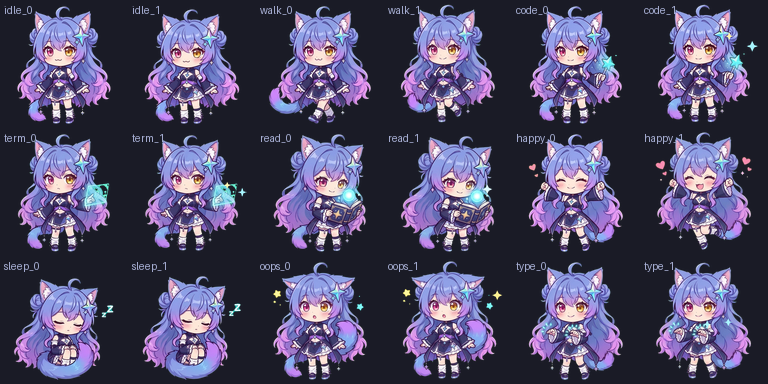
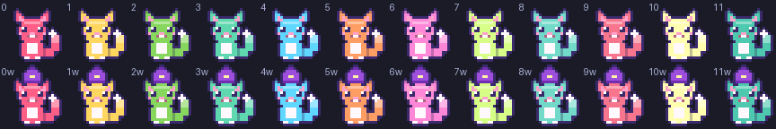
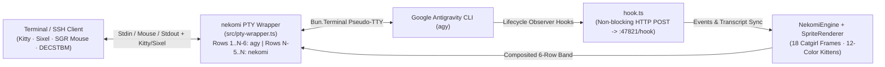

<div align="center">


# nekomi

**A terminal-native anime catgirl companion plugin for Google Antigravity CLI (`agy`)**  
*Kitty Graphics · Sixel · 24-bit Half-Block Fallback · SSH-Ready · 100% Bun Runtime*

[](https://github.com/wray-lee/nekomi)
[](https://bun.sh)
[](./src/gfx-protocol.ts)
[](#-quick-start)
[](./LICENSE)

**English** · [简体中文](./README.zh-CN.md) · [日本語](./README.ja.md)

[Showcase](#-visual-showcase) · [Features](#-highlights) · [Quick Start](#-quick-start) · [Protocols](#-terminal-graphics-support) · [Controls](#-controls--interactions) · [Architecture](#-architecture)

</div>

---

**nekomi** brings an expressive, interactive anime catgirl companion directly inside your terminal and SSH sessions alongside `agy` — powered by Bun's native PTY (`Bun.Terminal`), **pure-code 256×256 supersampled cel-shaded sprites** (zero AI artifacts), terminal native image protocols (**Kitty** & **Sixel**), SGR mouse click reactions, live typing echo, and **12-color pixel kittens** for active subagents.

Inspired by [`wray-lee/clawd`](https://github.com/wray-lee/clawd), rebuilt from the ground up for Google Antigravity CLI with original character-integrated animations.

---

## ✨ Visual Showcase

### Main Character — 18 Integrated Animation Frames (`256×256 → 128×128 PNG / 96×96 Sixel`)

<div align="center">
  
</div>

All props and visual effects are rendered **directly onto the character sprite** rather than external ASCII boxes:
- `idle_0 / idle_1` — gentle `:3` breathing, blink, ear twitch, and tail sway
- `walk_0 / walk_1` — bouncy stroll during model thinking (`PreInvocation`)
- `code_0 / code_1` — 4-point Gemini star wand & orbiting stardust (`edit_file`, `write_file`, `run_workflow`)
- `term_0 / term_1` — paws tapping a floating crystal rune-pad (`run_command`, `call_mcp_tool`, `browser_*`)
- `read_0 / read_1` — illuminated grimoire with rising starlight orb (`read_file`, `search_web`, `plan`, `update_steps`)
- `happy_0 / happy_1` — `^ ^` eyes, lucky-cat paws with pink paw-pads & floating hearts (`hello`, `pet`, `celebrate`, `highfive`)
- `sleep_0 / sleep_1` — curled cozy nap with rising `z` / `Z` after 10 minutes idle
- `oops_0 / oops_1` — startled wide eyes, flattened ears, bristled vertical tail & dizzy stars (`error`, `bonk`, `zap`)
- `type_0 / type_1` — eager paws tapping along with every keystroke (`echo`)

### Subagent Helpers — 12-Color Pixel Kittens (`72×72 PNG / 48×48 Sixel`)

<div align="center">
  
</div>

Active subagents line up behind nekomi as hopping, blinking multi-colored pixel kittens (depth-scaled for nested subagents, wearing **purple star wizard hats** for `run_workflow` tasks, with `+N` overflow counters beyond capacity).

---

## 🚀 Highlights

- **Pure-Code Vector Sprites**: Synthesized deterministically in Python (`256×256` splines + smooth vertical hair/iris gradients + delicate `#3a2a6b` lineart) — crisp transparent PNGs (`128×128`) and quantized `P2=1` transparent Sixels (`96×96`).
- **Lazy Kitty Upload & SSH Speed**: Starts instantly over SSH; Kitty frames upload lazily on first appearance using quiet chunked Base64 (`q=2`), then animate via tiny placement swaps (`d=i` / `a=p`).
- **SSH-Native Single-Window PTY (No `tmux` Required)**: Reserves a 6-row bottom band via DECSTBM inside `Bun.Terminal`, keeping `agy`'s full TUI cleanly contained above.
- **Native `agy` Plugin Packaging**: Ships with [`plugin.json`](./plugin.json), root [`hooks.json`](./hooks.json) (5 non-blocking observer hooks — never gates `PreToolUse`), and a bundled [`nekomi-setup`](./skills/nekomi-setup/SKILL.md) skill.
- **100% Bun Runtime**: Powered exclusively by `bun` (`Bun.Terminal`, `Bun.serve`, `bun test`) with zero Node/npm dependencies.

---

## 📦 Quick Start

### 1. Prerequisites

- [**Bun**](https://bun.sh) `>= 1.2.0`
- **Google Antigravity CLI** (`agy`)

### 2. Install as an `agy` Plugin (Hooks + Skill)

```sh
agy plugin install https://github.com/wray-lee/nekomi
```

### 3. Run nekomi

> [!NOTE]
> Because child hook pipes cannot shrink `agy`'s already-open terminal viewport or intercept raw `stdin` mouse events, launch `agy` through **nekomi**'s PTY wrapper (either directly or via a shell function):

```sh
# Launch interactive demo showcase (all animations + kitten helpers)
bun run demo

# Launch agy inside nekomi's bottom 6-row companion band (Linux / macOS / SSH)
./nekomi

# Windows (CMD / PowerShell)
.\nekomi.cmd

# Force a specific graphics protocol
./nekomi --gfx=kitty
./nekomi --gfx=sixel
./nekomi --gfx=halfblock
```

#### Optional: Auto-Launch When Typing `agy`

Add this wrapper to your shell profile so running `agy` automatically boots **nekomi**:

<details>
<summary><b>PowerShell (<code>$PROFILE</code>)</b></summary>

```powershell
function agy {
  $env:NEKOMI_CMD = (Get-Command agy.exe -CommandType Application | Select-Object -First 1 -ExpandProperty Source)
  bun run "$HOME/.gemini/config/plugins/nekomi/src/pty-wrapper.ts" @args
}
```

</details>

<details>
<summary><b>Bash / Zsh (<code>~/.bashrc</code> or <code>~/.zshrc</code>)</b></summary>

```sh
agy() {
  NEKOMI_CMD="$(command -v agy)" bun run "$HOME/.gemini/config/plugins/nekomi/src/pty-wrapper.ts" "$@"
}
```

</details>

---

## 🖼 Terminal Graphics Support

Selection order: `--gfx=<mode>` CLI flag → `NEKOMI_GFX` env var → `auto` detection.

| Terminal / Environment | Detected Protocol | Transparency & Notes |
| :--- | :---: | :--- |
| **Ghostty** / **WezTerm** / **Kitty** / **Konsole** | `kitty` | Lazy-loaded `128×128` PNG + `72×72` helper kittens, `z=-1`, `q=2` quiet mode |
| **Windows Terminal (1.22+)** / **iTerm2** / **mintty** / **foot** / **mlterm** | `sixel` | Pre-encoded `96×96` + `48×48` kittens with `P2=1` transparent background |
| **Other SSH / Plain Terminals** | `halfblock` | Seamless fallback to 24-bit ANSI `▀` sprite + mini pixel kittens |

---

## 🎮 Controls & Interactions

### PTY Wrapper Mode (`nekomi` / `nekomi.cmd`)

> [!TIP]
> Native terminal **mouse wheel scrolling and text selection** stay enabled inside `agy` by default. Pass `--mouse` (or set `NEKOMI_MOUSE=1`) if you want to opt into SGR left/right click interactions on nekomi in the bottom band.

| Input | Action |
| :--- | :--- |
| **Native Scroll Wheel / Drag** | Scrolls `agy` scrollback and selects text natively (default) |
| **Left Click on nekomi (`--mouse`)** | Triggers context-aware click reaction (`pet`, `spin`, `bonk`, `zap`, `peek`, `found`, `poof`, `shoo`, `wake`, `highfive`) |
| **Right Click in Bottom Band (`--mouse`)** | Plays full animation + subagent kittens showcase |
| **Typing in `agy` Prompt** | Real-time typing `echo` (paws tap fast + live key bubble; wakes sleeping nekomi) |

### Standalone / `tmux` Pane Mode (`bun run demo` / `bun run tui`)

| Key / Input | Action |
| :---: | :--- |
| **Left Click** | Poke nekomi (reacts based on current state) |
| `d` | Trigger full 14-step action & kitten showcase |
| `h` | Toggle 12-color subagent kittens |
| `g` | Live-cycle graphics protocol (`kitty` → `sixel` → `halfblock`) |
| `s` | Put nekomi to sleep (`sleep_0 / sleep_1`) |
| `q` | Quit cleanly and release terminal graphics memory |

---

## 🏗 Architecture



### Repository Layout

```text
nekomi/
├── plugin.json              # Antigravity plugin manifest
├── hooks.json               # 5 non-blocking observer hooks (runs via `bun ./hook.ts`)
├── skills/nekomi-setup/     # Bundled setup & troubleshooting skill
├── src/
│   ├── engine.ts            # NekomiEngine state machine, fidgets & subagent lineup
│   ├── actions.ts           # Activity animations, 14 non-repeating fidgets & click reactions
│   ├── gfx-protocol.ts      # Kitty / Sixel / half-block detection, encoders & lazy renderer
│   ├── pty-wrapper.ts       # SSH-ready Bun.Terminal PTY compositor + HTTP hook server
│   ├── tui-standalone.ts    # Standalone / tmux pane mode + interactive showcase
│   ├── tui-render.ts        # 6-row ANSI compositor & body hit-testing
│   ├── tui-sprite.ts        # 24-bit half-block fallback sprites
│   ├── input-parser.ts      # SGR 1006 mouse & printable keystroke parser
│   ├── palette.ts           # 12-color kitten palette
│   └── types.ts             # Shared TypeScript interfaces
├── assets/sprites/          # Pre-rendered 128x128 PNGs, 96x96 Sixels & 12-color kittens
├── scripts/build-sprites.py # Pure-code 256x256 supersampled sprite generator
├── tests/                   # Bun unit & protocol tests (`bun test`)
├── nekomi / nekomi.cmd      # Cross-platform PTY launchers
└── hook.ts                  # Stdin JSON -> local HTTP bridge (always prints `{}`)
```

---

## 🛠 Development

```sh
# Run all unit & protocol tests (Bun)
bun test

# Rebuild all PNG + Sixel sprite sheets (requires Python 3 + Pillow)
bun run build:sprites

# Test hook bridge safely via stdin
echo '{"hookEventName":"SessionStart"}' | bun run hook.ts
```

---

## 🙏 Credits & License

- Animation mechanics and companion architecture inspired by [`wray-lee/clawd`](https://github.com/wray-lee/clawd).
- Licensed under the [MIT License](./LICENSE).
