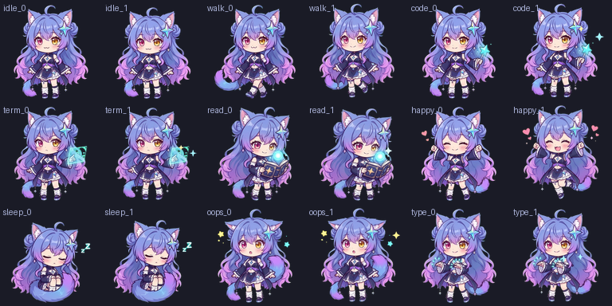
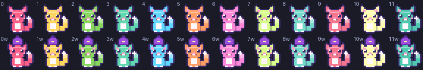
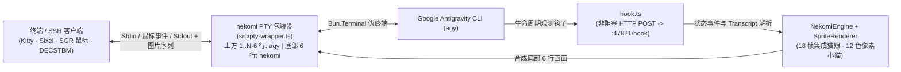

<div align="center">


# nekomi

**为 Google Antigravity CLI（`agy`）打造的终端原生二次元猫娘伴侣插件**  
*Kitty 图片协议 · Sixel · 24-bit 半块回退 · SSH 原生可用 · 100% Bun 运行时*

[](https://github.com/wray-lee/nekomi)
[](https://bun.sh)
[](./src/gfx-protocol.ts)
[](#-快速开始)
[](./LICENSE)

[English](./README.md) · **简体中文** · [日本語](./README.ja.md)

[视觉展示](#-视觉展示) · [核心亮点](#-核心亮点) · [快速开始](#-快速开始) · [图片协议支持](#-终端图片协议支持) · [操作与互动](#-操作与互动) · [架构设计](#-架构设计)

</div>

---

**nekomi** 将一位灵动可爱的猫娘桌宠直接带入你的本地终端与 SSH 会话中，实时响应 `agy` 的工作状态——基于 Bun 原生伪终端（`Bun.Terminal`）、**纯代码 `256×256` 超采样赛璐璐精灵**（零 AI 抠图瑕疵）、终端原生图片协议（**Kitty** / **Sixel**）、SGR 鼠标点击互动、实时打字同步 `echo`，以及由 **12 色像素小猫** 组成的子代理队列。

灵感源自 [`wray-lee/clawd`](https://github.com/wray-lee/clawd)，围绕猫娘形象彻底重制了角色一体化原创动画。

---

## ✨ 视觉展示

### 主角猫娘 — 18 帧一体化角色动画（`256×256 → 128×128 PNG / 96×96 Sixel`）

<div align="center">
  
</div>

所有道具与状态特效均**直接绘制在角色画布内**，而非拼贴外部 ASCII 框：
- `idle_0 / idle_1` — `:3` 猫嘴轻呼吸、眨眼、单侧猫耳轻抖与摇尾
- `walk_0 / walk_1` — 思考阶段轻快踱步与甩袖摆尾（`PreInvocation`）
- `code_0 / code_1` — 举起发光四角星杖与环绕星尘（`edit_file`、`write_file`、`run_workflow`）
- `term_0 / term_1` — 立耳敲击悬浮晶石符文光板（`run_command`、`call_mcp_tool`、`browser_*`）
- `read_0 / read_1` — 捧读发光星辉法典与浮空星光球（`read_file`、`search_web`、`plan`、`update_steps`）
- `happy_0 / happy_1` — `^ ^` 笑眼、招财猫爪肉垫手势与飘浮爱心（`hello`、`pet`、`celebrate`、`highfive`）
- `sleep_0 / sleep_1` — 闲置 10 分钟后抱尾蜷坐小憩，伴随升起的 `z` / `Z`
- `oops_0 / oops_1` — 睁大异色瞳、压平猫耳、竖直炸毛猫尾与晕眩小星（`error`、`bonk`、`zap`）
- `type_0 / type_1` — 随着你的每次按键同步快速敲爪（`echo`）

### 子代理 Helpers — 12 色像素小猫（`72×72 PNG / 48×48 Sixel`）

<div align="center">
  
</div>

活跃中的子代理会化身不同颜色的像素小猫排在 nekomi 身后，随嵌套层级自动缩放并跳跃眨眼；执行 `run_workflow` 的小猫还会戴上**紫色星星巫师帽**，超出数量时在角落显示 `+N` 计数。

---

## 🚀 核心亮点

- **纯代码矢量超采样绘图**：由 Python 从 `256×256` 样条曲线与连续渐变直接生成，导出高清透明 PNG（`128×128`）与 `P2=1` 透明背景 Sixel（`96×96`）。
- **Kitty 懒上传，SSH 极速启动**：SSH 下零阻塞瞬开；仅在某个动作帧首次出现时通过静默分片 Base64（`q=2`）上传一次，后续切帧只发极短的 `d=i` / `a=p` 定位控制码。
- **SSH 单窗口原生可用（无需 `tmux`）**：利用 `Bun.Terminal` 与 DECSTBM 在终端底部划出 6 行专属区域，与上方 `agy` 全屏界面互不覆盖。
- **标准 `agy` Plugin 封装**：内置 [`plugin.json`](./plugin.json)、根目录 [`hooks.json`](./hooks.json)（5 个只读观测钩子，绝不拦截 `PreToolUse`）以及 [`nekomi-setup`](./skills/nekomi-setup/SKILL.md) Skill。
- **100% Bun 运行时**：全程使用 `bun`（`Bun.Terminal`、`Bun.serve`、`bun test`），无任何 Node / npm 依赖。

---

## 📦 快速开始

### 1. 环境要求

- [**Bun**](https://bun.sh) `>= 1.2.0`
- **Google Antigravity CLI**（`agy`）

### 2. 作为 `agy` Plugin 一键安装（Hooks + Skill）

```sh
agy plugin install https://github.com/wray-lee/nekomi
```

### 3. 启动 nekomi

> [!NOTE]
> 由于 Hook 作为 `agy` 管道子进程无法反向压缩已经打开的终端视图或截获 `stdin` 鼠标事件，请通过 **nekomi** 的 PTY 包装器启动 `agy`（直接运行或配置同名 Shell 函数均可）：

```sh
# 运行离线演示模式（循环展示全部 18 帧动作与 12 色小猫）
bun run demo

# 在底部 6 行伴侣区中启动 agy（Linux / macOS / SSH）
./nekomi

# Windows（CMD / PowerShell）
.\nekomi.cmd

# 手动指定图片协议
./nekomi --gfx=kitty
./nekomi --gfx=sixel
./nekomi --gfx=halfblock
```

#### 可选：配置敲 `agy` 自动伴随启动

将下面这段包装函数加入你的 Shell 配置后，直接输入 `agy` 即可自动带出猫娘：

<details>
<summary><b>PowerShell（<code>$PROFILE</code>）</b></summary>

```powershell
function agy {
  $env:NEKOMI_CMD = (Get-Command agy.exe -CommandType Application | Select-Object -First 1 -ExpandProperty Source)
  bun run "$HOME/.gemini/config/plugins/nekomi/src/pty-wrapper.ts" @args
}
```

</details>

<details>
<summary><b>Bash / Zsh（<code>~/.bashrc</code> 或 <code>~/.zshrc</code>）</b></summary>

```sh
agy() {
  NEKOMI_CMD="$(command -v agy)" bun run "$HOME/.gemini/config/plugins/nekomi/src/pty-wrapper.ts" "$@"
}
```

</details>

---

## 🖼 终端图片协议支持

优先级：`--gfx=<mode>` 命令行参数 → `NEKOMI_GFX` 环境变量 → `auto` 自动识别。

| 终端 / SSH 环境 | 自动识别协议 | 透明渲染与特性说明 |
| :--- | :---: | :--- |
| **Ghostty** / **WezTerm** / **Kitty** / **Konsole** | `kitty` | 懒加载上传 `128×128` PNG 与 `72×72` 像素小猫，`z=-1`，`q=2` 静默无回显 |
| **Windows Terminal (1.22+)** / **iTerm2** / **mintty** / **foot** / **mlterm** | `sixel` | 预编码 `96×96` 主角与 `48×48` 小猫，`P2=1` 全透明背景 + RLE 压缩 |
| **其他纯文本终端 / 传统 SSH** | `halfblock` | 无缝回退至 24-bit 彩色 `▀` 半块精灵与迷你像素小猫 |

---

## 🎮 操作与互动

### PTY 伴侣模式（`nekomi` / `nekomi.cmd`）

> [!TIP]
> 为保留终端内对 `agy` 的**原生鼠标滚轮翻页与文字选中复制**，PTY 模式默认不劫持外层鼠标。如需开启底部猫娘的鼠标点击互动，启动时传入 `--mouse`（或设置 `NEKOMI_MOUSE=1`）即可。

| 操作 | 响应效果 |
| :--- | :--- |
| **终端鼠标滚轮 / 拖选复制** | 原生滚动 `agy` 历史输出与划词复制（默认开启） |
| **左键点击猫娘（`--mouse`）** | 按当前状态触发专属彩蛋反应（`pet`、`spin`、`bonk`、`zap`、`peek`、`found`、`poof`、`shoo`、`wake`、`highfive`） |
| **右键点击底部 6 行区（`--mouse`）** | 触发完整动作 + 多只子代理小猫演示 |
| **在 `agy` 中打字** | 实时触发敲爪动画 `echo` 并在身旁举起最后键入的字符（睡着时立即唤醒） |

### 独立演示 / `tmux` Pane 模式（`bun run demo` / `bun run tui`）

| 按键 / 点击 | 功能 |
| :--- | :--- |
| **鼠标左键点击角色** | 触发对应动作彩蛋 |
| `d` | 播放全套 14 步动作与小猫演示 |
| `h` | 开关多只 12 色子代理小猫（含 Workflow 紫色星帽） |
| `g` | 实时循环切换图片协议（`kitty` → `sixel` → `halfblock`） |
| `s` | 切换休眠打盹状态（`sleep_0 / sleep_1`） |
| `q` | 优雅退出并自动清理终端图片显存 |

---

## 🏗 架构设计



---

## 🛠 本地开发与构建

```sh
# 运行全部 Bun 单元测试与协议测试
bun test

# 重新生成全部 256->128/96 PNG 与 Sixel 资源（需 Python 3 + Pillow）
bun run build:sprites

# 安全测试 Hook 桥接输出（固定返回 `{}`）
echo '{"hookEventName":"SessionStart"}' | bun run hook.ts
```

---

## 🙏 致谢与许可

- 核心交互机制与状态机设计致敬 [`wray-lee/clawd`](https://github.com/wray-lee/clawd)。
- 本项目基于 [MIT License](./LICENSE) 开源。
